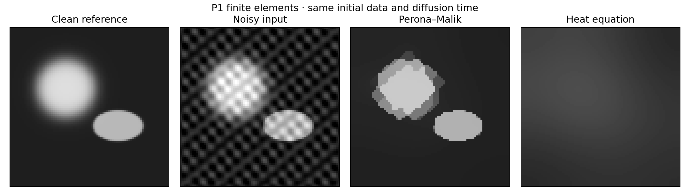
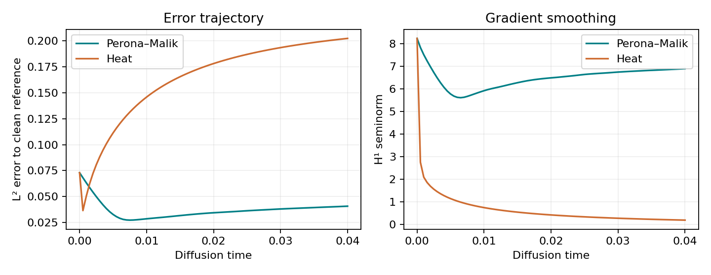

# Perona–Malik image denoising with finite elements

**Can edge-dependent diffusion remove oscillatory noise while retaining more structure than uniform heat diffusion?** A reproducible P1 finite-element benchmark with a known synthetic clean image, quantitative error trajectories and conservation checks.

Jihad Boussata · FreeFEM · Python · variational methods · nonlinear diffusion



## Results on this synthetic benchmark

| Measurement | L² error |
| --- | --- |
| Noisy input | 0.07292 |
| Perona–Malik at final time | 0.04061 |
| Heat at final time | 0.20248 |
| Best Perona–Malik step (oracle) | 0.02717 at step 15 |
| Best heat step (oracle) | 0.03638 at step 1 |

Uniform heat diffusion oversmooths at the shared final time. Reporting each method's best sampled step makes the stopping-time dependence visible. Those minima use the known clean image and are **oracle benchmark diagnostics**, not an available stopping rule for a real unknown image. Default parameters are illustrative choices for this phantom, not a validated general-purpose denoiser.



## Reproduce

Install FreeFEM (validated with 4.13) and Python 3.12. On Ubuntu, `sudo apt-get install freefem++`. From this repository, with a virtual environment activated:

```bash
python -m pip install -r requirements.txt
python -m unittest discover -s tests -v
python scripts/run.py
```

Default: 80×80 square mesh, 80 steps, dt=0.0005, kappa=1. The runner creates output directories, runs FreeFEM without a graphical session and writes CSV fields, an error history, parameters and figures to `results/`. Change `--n`, `--steps`, `--dt`, `--kappa`, `--output` or `--freefem` as needed. If FreeFEM is absent, numerical unit tests are marked skipped; a full verification requires it. The configured CI installs it.

## Numerical design

P1 image intensities solve a lagged, semi-implicit diffusion equation. Diffusivity is g=1/(1+|grad u_previous|²/kappa²), represented cellwise in P0. A natural no-flux condition conserves spatial mean. The same mesh, mass matrix, initial image and time steps are used for the heat comparator (g=1).

Tests check constant-image preservation, no-flux mass conservation and monotone heat-gradient smoothing. The measured maximum mass drift is below 9.0e-15. This verifies discrete invariants; it does not establish continuum well-posedness or convergence of the original Perona–Malik equation.

## Origin, changes and limits

Developed from my diffusion/PDE coursework. A key correction replaces the original sin(80πx) noise term: it vanishes at every x-coordinate of an 80-interval mesh. The revised frequencies are resolved by the default mesh. Cellwise diffusivity also avoids nodal ambiguity in discontinuous P1 gradients. Results are therefore a revised benchmark, not a claim to reproduce the old assignment figures unchanged.

The input is a deterministic synthetic phantom with oscillatory noise, not a photograph or a learned model. No conclusions about real-camera noise or all images follow from this example. See [mathematical method](docs/METHODOLOGY.md) and [change record](docs/CHANGES.md).

Method source: Perona and Malik (1990), [Scale-space and edge detection using anisotropic diffusion](https://doi.org/10.1109/34.56205). Solver: [FreeFEM](https://freefem.org/), Hecht (2012), New development in FreeFem++. New implementation and generated synthetic data are MIT licensed.
